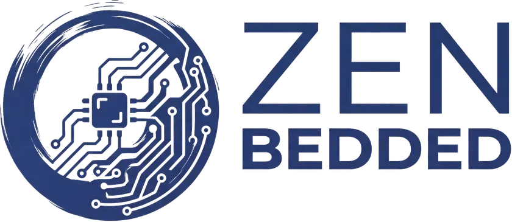

<picture>
  <source media="(prefers-color-scheme: dark)" srcset="doc/images/zenbedded_logo.png">
  <source media="(prefers-color-scheme: light)" srcset="doc/images/zenbedded_logo.png">
  
</picture>

<p>
  <a href="https://opensource.org/licenses/Apache-2.0"></a>
  <a href="https://github.com/ros-controls/zenbedded/actions/workflows/lyrical-binary-build.yml?branch=master"></a>
  <a href="https://github.com/ros-controls/zenbedded/actions/workflows/zephyr-twister.yml?branch=master"></a>
</p>

Zephyr-based microcontrollers as first-class `ros2_control` hardware, communicating
with the ROS 2 host directly over [Zenoh](https://zenoh.io/) — without a micro-ROS
agent or bridge process. The host side is `zenbedded_hardware_interface`; the MCU side
is `zenbedded_rcl` and `zenbedded_transport`, built from one `interface_schema.yaml`.
Tier 1 uses CDR-encoded ROS 2 messages; Tier 2 uses schema-packed payloads.

## Supported distributions

| ROS 2 Distro | Branch | Host build | Documentation |
| :---------: | :----: | :--------: | :-----------: |
| **Lyrical** | [`master`](https://github.com/ros-controls/zenbedded/tree/master) | [](https://github.com/ros-controls/zenbedded/actions/workflows/lyrical-binary-build.yml?branch=master) | [Documentation](https://control.ros.org/rolling/doc/zephyr-zenoh-integration/doc/index.html) |
| **Kilted** | [`master`](https://github.com/ros-controls/zenbedded/tree/master) | | [Source build](doc/supported_distributions.rst) |
| **Jazzy** | [`master`](https://github.com/ros-controls/zenbedded/tree/master) |  | [Source build](doc/supported_distributions.rst) |
| **Humble and older** | — |  | — |

Lyrical is validated end-to-end. Kilted and Jazzy use the same `master` sources; their
CI lanes are planned after the first release.

## Supported hardware

Platform | Status | Notes
:------: | :----: | :----
`esp32s3_devkitc/esp32s3/procpu` |  | Reference target; built in CI and used by all demos
`native_sim/native/64` |  | CI test target; no radio
Other Zephyr boards |  | Requires a network interface supported by zenoh-pico

Zephyr v4.4.2 and the `zenbedded` zenoh-pico fork are pinned in
[`docker/image-west.yml`](docker/image-west.yml).

## Quick start

The development image provides ROS 2 Lyrical, `ros2_control`, Zephyr, and zenoh-pico.

```bash
git clone https://github.com/ros-controls/zenbedded.git
cd zenbedded
docker compose up -d
docker compose exec -it dev-env bash
```

Build the host packages:

```bash
cd /ros2_ws
rosdep install --from-paths src --ignore-src -r -y
colcon build --packages-select zenbedded_hardware_interface
source install/setup.bash
```

Build and flash the firmware:

```bash
cd /zephyr_ws/demos/inverted_pendulum/inverted_pendulum_tier2
west build -p always -b esp32s3_devkitc/esp32s3/procpu
west flash --esp-device /dev/ttyUSB0
```

Run the host side:

```bash
ros2 run rmw_zenoh_cpp rmw_zenohd
ros2 launch zenbedded_inverted_pendulum inverted_pendulum.launch.py
```

Add `use_mock_hardware:=true` to the launch command to run without an MCU. See
[Getting Started](doc/getting_started.rst) for Wi-Fi setup and the full walkthrough.

## Documentation

- [control.ros.org](https://control.ros.org/rolling/doc/zephyr-zenoh-integration/doc/index.html)
- [Getting Started](doc/getting_started.rst)
- [Supported ROS 2 Distributions](doc/supported_distributions.rst)
- [Architecture](doc/architecture.rst)

Demos: [`inverted_pendulum`](demos/inverted_pendulum) and
[`sine_wave`](demos/sine_wave).

## Contributing

As an open-source project, we welcome each contributor, regardless of their background and experience. Pick a [PR](https://github.com/ros-controls/zenbedded/pulls) and review it, or [create your own](https://github.com/ros-controls/zenbedded/contribute)!
If you are new to the project, please read the [contributing guide](https://control.ros.org/rolling/doc/contributing/contributing.html) for more information on how to get started.

## License

Apache-2.0. See [`LICENSE`](LICENSE).

## Known limitations

- Packages are built from source; there is no rosdistro release yet.
- Only Lyrical is CI-tested; Kilted and Jazzy are source builds.
- A standalone Zephyr workspace is not supported yet; use the development container.
